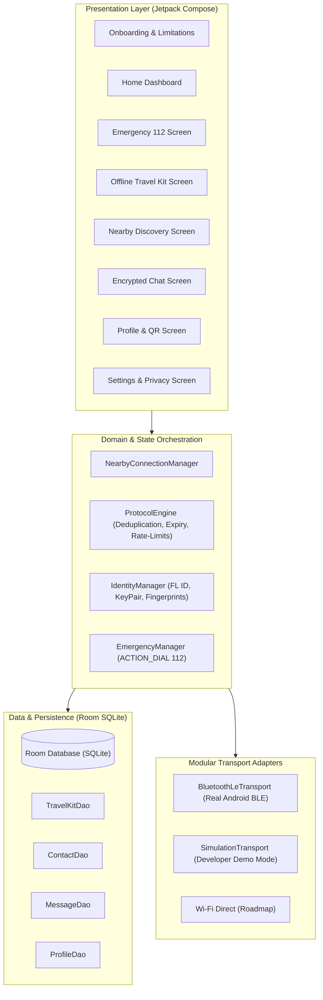
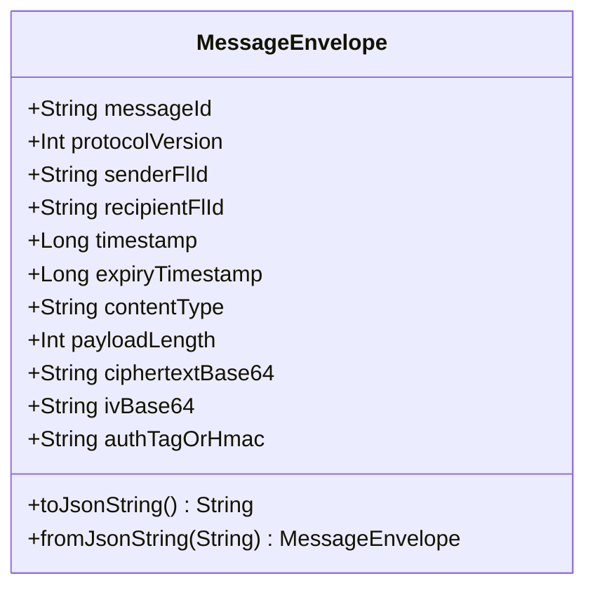
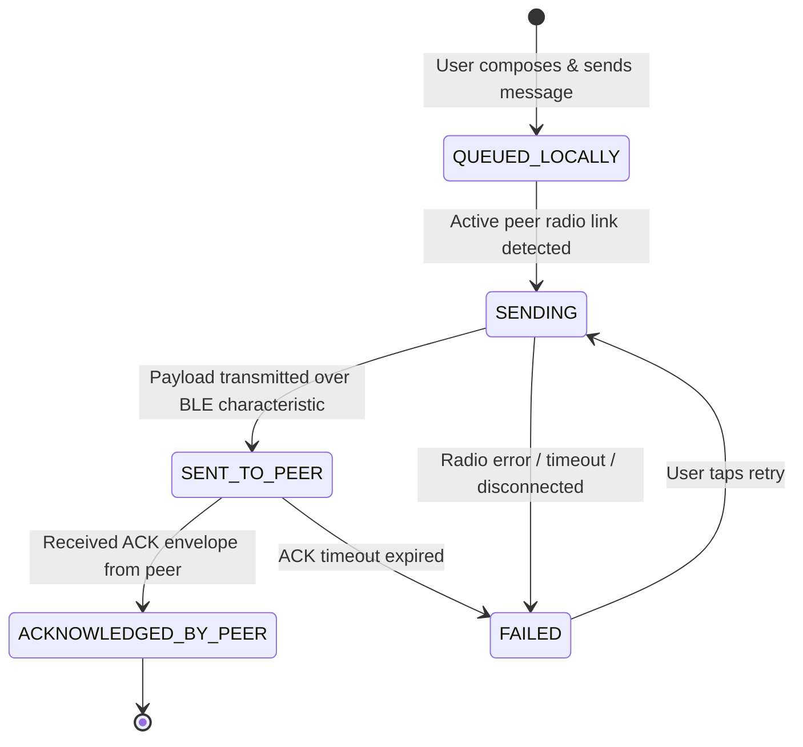

# FREELINK — System Architecture & Design Specification

> **Core Philosophy**: Help the user recover a communication path honestly; never claim to create a carrier connection from nothing.

---

## 1. High-Level Architectural Overview

FREELINK is architected as an **offline-first**, modular Android application designed to provide immediate emergency assistance, local safety reference, and proximity-based device-to-device communication when prepaid recharge or mobile data services expire mid-journey.

---

## 2. Layered Resilience Model

| Layer | Module | Offline Capability | Responsibility |
|---|---|---|---|
| **Layer 1: Emergency** | `safety.EmergencyManager` | **100% Offline** | Hands off emergency calls to India's 112 ERSS via native `ACTION_DIAL`. Provides actionable landmark checklist. |
| **Layer 2: Reconnection** | `online.OperatorDirectory` | **100% Offline + Online links** | Displays verified USSD codes (`*121#`, `*333#`, `*199#`, `*123#`) and anti-phishing Wi-Fi advice. |
| **Layer 3: Nearby Link** | `nearby.NearbyConnectionManager` | **100% Offline** | Scans for nearby peers, exchanges explicit consent, and establishes local encrypted sessions. |
| **Layer 4: Online Fallback** | `online.RegistryClient` | **Opportunistic** | When internet is active, validates FL IDs against central registry without blocking offline features. |
| **Layer 5: Travel Kit** | `data.local.TravelKit` | **100% Offline** | Stores trusted contacts, medical info, meeting points, and emergency notes in local SQLite. |

---

## 3. Wire Protocol & Cryptographic Envelope

All proximity messages are framed in a bounded wire envelope with a strict **4096-byte limit** to mitigate denial-of-service and buffer exhaustion vulnerabilities.

### Encryption Specification
- **Algorithm**: Authenticated Encryption with Associated Data (AEAD) using `AES-256-GCM` (`AES/GCM/NoPadding`).
- **Initialization Vector**: 96-bit (12 bytes) cryptographically secure random IV generated per envelope.
- **Authentication Tag**: 128-bit authentication tag ensuring ciphertext integrity.
- **Key Derivation**: SHA-256 HKDF/PBKDF derivative seeded by exchanging peer FL IDs and public key fingerprints.
- **Zero-Trust Rule**: Private keys and plaintext passwords never enter the wire envelope or QR code.

---

## 4. Message Delivery State Machine

Messages strictly reflect real-world physical transmission states. A message is never falsely marked as "Sent" if the local radio has not transmitted it, and never marked as "Delivered" until a cryptographic ACK envelope is received from the peer.

---

## 5. Explicit User Consent Flow

To prevent unwanted tracking or unsolicited transmissions in crowded train stations or bus terminals:
1. Scanning broadcasts only an anonymous service UUID and 10-digit FL ID prefix.
2. When a peer attempts to connect or transmit, a `PeerConsentDialog` is presented to the user.
3. If declined, the connection is immediately terminated and no messages are processed.
4. Users can toggle **Developer Demo Simulation Mode** in Settings to test and verify the state machine without needing two physical handsets.
